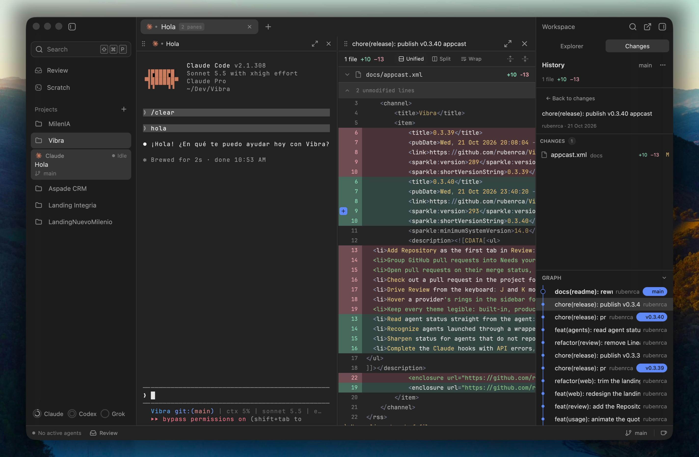

# Vibra

A native macOS development workspace written in Rust with GPUI. It brings
persistent terminals, projects, files, Git diffs, pull request review, and AI
agent tracking into a single window.



## Install

Download the latest `Vibra.dmg` from [tryvibra.dev](https://tryvibra.dev) or
[Releases](https://github.com/rubenrca/Vibra/releases/latest).
Vibra requires macOS 14 or later and updates itself with Sparkle (`⌘U` checks for
updates).

## Features

- **Projects and terminals.** Each project is a folder with its own persistent
  tabs and panes. Panes split in any direction and can be reordered, turned into
  tabs, or zoomed by dragging or with shortcuts. **Scratch** (`⌥⌘T`) is a terminal
  outside every project.
- **Native terminal.** A built-in PTY with `libghostty-vt` emulation, GPUI/Metal
  rendering, xterm and Kitty keyboard, SGR mouse, IME, search, and OSC 8 links.
- **Files and Git.** An Explorer confined to the project, a file viewer, and a
  Changes panel with staging, commit (the message can be drafted by your CLI
  agent), push, pull, a commit graph, and branch comparison. Diffs are unified or
  side by side, with syntax highlighting and per-line comments that paste into
  the agent's terminal.
- **Review.** GitHub issues and pull requests (through `gh`) with filters,
  Markdown detail, a diff with **Viewed** and **Since last review**, checks,
  published reviews, and merge with confirmation. **Send to agent** and **Ask**
  hand a task to Claude, Codex, or Gemini in a visible tab. **Repository** is a Git
  client for branches, worktrees, stashes, and tags. A pull request opens in a
  checkout or in its own worktree.
- **Agents.** Detects Claude Code, Codex, Gemini, Grok, OpenCode, Cursor, Aider,
  Amp, Goose, and Pi, and shows whether each is working, waiting for permission
  or an answer, or done. It reads the status the agent reports itself through the
  [Program Status Protocol](https://www.superlogical.com/rex/docs/build/program-status)
  (OSC 7501) and sends a notification when one needs you while its pane is out of
  sight.
- **AI usage.** Subscription usage for Claude Code, Codex, and Grok Build in the
  sidebar footer, read from each CLI's current session. Vibra never stores or
  modifies credentials.
- **Customization.** Command palette (`⇧⌘P`), quick open (`⌘P`), translucency over
  the macOS blur (switch it off in Settings → Appearance), built-in themes plus
  Warp YAML or Ghostty themes in `~/.vibra/themes`, and **Keep Awake** to prevent
  sleep.

Vibra does not orchestrate agents from the terminal: it does not create panes or
launch agents in other sessions. You run whichever CLI you prefer and Vibra keeps
track of its status and notifications.

### Optional hooks

Detection works without any setup. To get task titles, the model, and status from
Claude and Codex versions that do not report OSC 7501 yet, install the hooks from
**Settings → Agent activity → Install hooks**, or from a Vibra terminal:

```bash
"$VIBRA_CLI" agent setup
"$VIBRA_CLI" agent status
"$VIBRA_CLI" agent uninstall codex
```

This only adds Vibra's handlers to `~/.claude/settings.json` and
`~/.codex/hooks.json`, keeps your existing hooks, and does nothing outside a Vibra
pane. After installing the Codex hook, open Codex once and approve it in `/hooks`.

## Shortcuts

| Shortcut | Action |
| --- | --- |
| `⇧⌘O` | Add a project |
| `⌘T` / `⌘W` | New tab / close the pane or open review |
| `⌘1`–`⌘9` | Go to tab 1–8 / the last tab |
| `⌥1`–`⌥9` | Go to project 1–8 / the last project |
| `⌃⌘[` / `⌃⌘]` | Previous / next project |
| `⌃⌘←` / `⌃⌘→` | Back / forward through navigation |
| `⌘D` / `⇧⌘D` | Split right / down |
| `⌥⌘` + arrows | Focus the neighboring pane |
| `⇧⌘↵` | Zoom or restore the pane |
| `⇧⌘P` / `⌘P` | Command palette / quick open |
| `⌘,` | Settings |
| `⌘B` / `⌥⌘B` | Toggle the sidebar / the Workspace panel |
| `⌘F` | Search the terminal |

In Review, `?` lists its shortcuts.

## Development

Requires macOS 14+, Xcode, and Rust 1.96 (pinned in `rust-toolchain.toml`).

```bash
./Scripts/fetch_ghostty.sh        # once: builds libghostty-vt inside .build/
cargo run                         # or: cargo run -- /path/to/project
cargo run --release               # to evaluate performance
./Scripts/verify.sh               # format, tests, Clippy, plist, and scripts
```

If a folder is named `agent`, pass it as `./agent` so it is not read as the hooks
subcommand.

To build `Vibra.app`:

```bash
./Scripts/package_app.sh debug --sign -   # development bundle, ad-hoc signed
```

### Releases

A release needs a clean tree, the version in both `Cargo.toml` and `CHANGELOG.md`,
Sparkle downloaded with `./Scripts/fetch_sparkle.sh`, and `VIBRA_SIGNING_IDENTITY`
set to the full name of the Developer ID certificate:

```bash
./Scripts/release.sh 0.3.41 --dry-run
./Scripts/release.sh 0.3.41
```

A stable release builds the universal DMG, signs and notarizes it, signs the
appcast, publishes to GitHub as Latest, and updates `docs/appcast.xml`. A
`--prerelease` does not touch the Sparkle feed.

## Documentation

- [Architecture](docs/architecture.md): workspace responsibilities and the contracts for navigation, per-project isolation, and saving.
- [Ghostty integration](docs/ghostty.md).
- [MonoCode Inbox adaptation](docs/inbox-monocode.md): where Review comes from.
- [GPUI patches](third_party/gpui/VIBRA_PATCHES.md): Vibra bundles GPUI 0.2.2 with a fix for Metal alpha compositing.

## License

MIT. See [NOTICE.md](NOTICE.md) for dependencies and acknowledgments.
